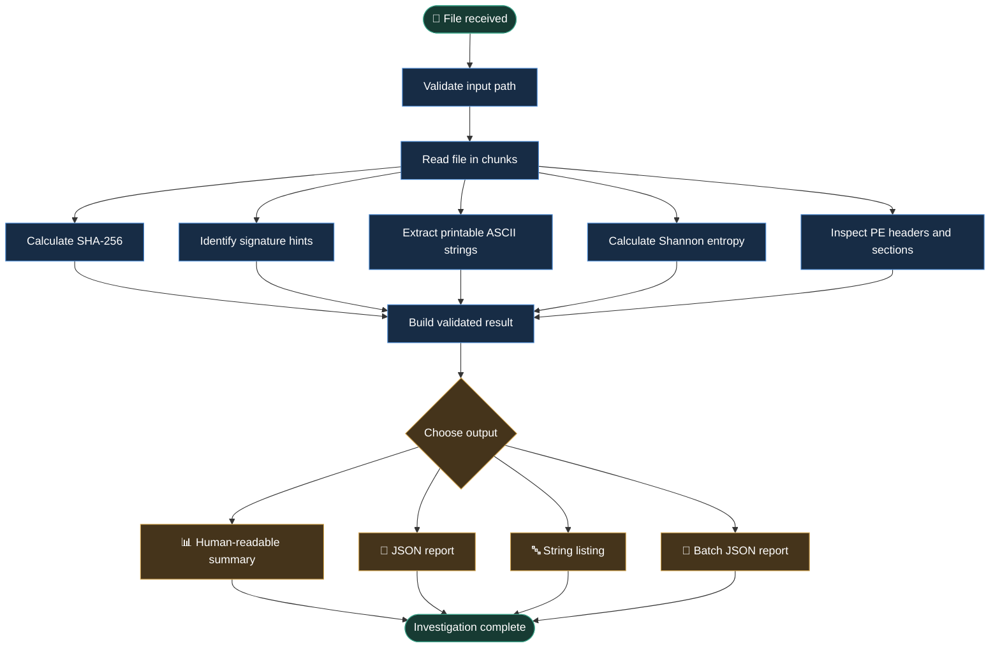

# 🔎 Reverse Engineering Intelligence

### Turn unknown files into structured intelligence.

**Inspect. Fingerprint. Investigate. Understand.**

A Python-powered, read-only static file analysis toolkit built to help security learners and developers inspect files, identify basic file signatures, extract printable strings, estimate entropy, and examine Windows PE headers, sections, and import tables — without intentionally executing or modifying the files being inspected.

[](https://github.com/ShahulAIEngineer/reverse-engineering-intelligence/actions/workflows/ci.yml)


[Explore the Repository](https://github.com/ShahulAIEngineer/reverse-engineering-intelligence) · [View CI Results](https://github.com/ShahulAIEngineer/reverse-engineering-intelligence/actions)

---

## 🕵️ The Investigation Begins

You receive a file.

Its name tells you almost nothing. Its extension might be misleading. You don't want to execute it just to learn what it contains.

**Where do you begin?**

Reverse Engineering Intelligence approaches the problem as a structured investigation. It reads the file, calculates a cryptographic fingerprint, looks for recognizable signatures, extracts printable ASCII strings, measures byte-level entropy, and checks selected Windows PE header and section metadata.

The result is a structured report you can inspect in your terminal or save as JSON.

> **The mission:** collect useful evidence first. Make conclusions only when the evidence supports them.

## 🗺️ The Investigation Workflow

Follow the file from intake to report.



### What happens at each stage?

| Stage | Investigation task | Result |
|---|---|---|
| 01 · Intake | Validate the file path | Confirm the target is a regular file |
| 02 · Fingerprint | Calculate SHA-256 | A reproducible file fingerprint |
| 03 · Identify | Check known byte signatures | A heuristic format hint |
| 04 · Extract | Find printable ASCII sequences | Potentially useful strings |
| 05 · Measure | Calculate Shannon entropy | A rough byte-distribution indicator |
| 06 · Examine | Inspect PE headers, sections, and imports | Architecture, section metadata, imported DLLs, and imported names or ordinals |
| 07 · Report | Validate and serialize results | Terminal output or JSON |

---

## ⚡ Features at a Glance

### 🔐 File fingerprinting

Calculates SHA-256 using chunked reads. Use the hash to identify a file consistently across reports.

### 🧭 Signature identification

Recognizes selected signatures associated with formats such as PE, ELF, PNG, JPEG, GIF, ZIP, and PDF.

Signature matches are hints, not proof that a file is valid.

### 🔤 Printable string extraction

Extracts printable ASCII sequences with configurable minimum length and a maximum result count.

### 📈 Entropy estimation

Calculates Shannon entropy in bits per byte, from 0 to 8, as one signal for further investigation.

### 🪟 Windows PE inspection

Reads selected PE/COFF header fields, section permissions, and the import table, including DLL names and imports by name or ordinal. Malformed import tables are reported explicitly instead of being silently treated as valid.

Available per-section metadata includes:

- Section name
- Virtual address and virtual size
- Raw file offset and raw size
- Readable, writable, and executable characteristics

PE inspection covers selected structures; it is not a complete PE parser.

### 📄 Structured reporting

Uses Pydantic models and JSON serialization to make analysis results easier to inspect and integrate into later workflows.

### 📁 Batch analysis

Analyzes files in a directory, optionally including subdirectories, and produces a JSON report containing individual results and errors.

### 🧪 Automated quality checks

Uses pytest for regression tests and Ruff for linting, with GitHub Actions for continuous integration.

### 🛡️ Read-only design

The analyzer is designed not to execute or modify inspected files. This is not a security sandbox.

---

## 🚀 Run Your First Investigation

### 1. Prepare the environment

**Requirements:** Python 3.11 or later, Git, and Windows, macOS, or Linux.

On Windows, open a terminal in the project directory.

Create a virtual environment:

```powershell
python -m venv .venv
```

Activate it in PowerShell:

```powershell
.\.venv\Scripts\Activate.ps1
```

Install the project and development dependencies:

```powershell
python -m pip install -e ".[dev]"
```

### 2. Choose your investigation mode

<details>
<summary><strong>📊 Mode 1 — Human-readable summary</strong></summary>

Get a quick overview of a file.

```powershell
re-intel summary sample.txt
```

The summary displays the file path, size, extension, SHA-256, signature hint, entropy, number of extracted strings, and PE metadata when detected.

</details>

<details>
<summary><strong>📄 Mode 2 — Detailed JSON report</strong></summary>

Generate structured output for inspection, archiving, or downstream processing.

```powershell
re-intel inspect sample.exe
```

Save the report to a file:

```powershell
re-intel inspect sample.exe --output report.json
```

A simplified illustrative report:

```json
{
  "name": "sample.exe",
  "extension": ".exe",
  "size_bytes": 4096,
  "sha256": "example_hash_replaced_by_actual_output",
  "signature": "Windows PE/DOS executable header (signature hint)",
  "entropy_bits_per_byte": 6.8,
  "printable_strings": [],
  "pe_metadata": {
    "machine": "x64",
    "section_count": 3,
    "is_dll": false,
    "is_executable": true,
    "import_table_status": "parsed",
    "imports": [
      {
        "name": "KERNEL32.dll",
        "symbols": [
          {"name": "CreateFileW"},
          {"ordinal": 7}
        ]
      }
    ],
    "sections": [
      {
        "name": ".text",
        "virtual_address": 4096,
        "virtual_size": 512,
        "raw_offset": 1024,
        "raw_size": 512,
        "readable": true,
        "writable": false,
        "executable": true
      }
    ]
  }
}
```

*Illustrative structure only. Values are examples, not results from a real executable. Section property names should match the installed version of the project's result model.*

</details>

<details>
<summary><strong>🔤 Mode 3 — Printable strings</strong></summary>

Inspect readable ASCII sequences without opening the file in an editor.

```powershell
re-intel strings sample.txt
```

Set the minimum string length:

```powershell
re-intel strings sample.txt --min-length 8
```

Limit the number of extracted strings:

```powershell
re-intel strings sample.txt --max-strings 100
```

</details>

<details>
<summary><strong>📁 Mode 4 — Batch file analysis</strong></summary>

Analyze files directly inside a directory and combine their results into one JSON report.

```powershell
re-intel batch examples/fixtures --output examples/reports/batch-report.json
```

Include files in subdirectories:

```powershell
re-intel batch examples/fixtures --recursive --output examples/reports/batch-report.json
```

The report records the generation timestamp, input directory, whether recursive discovery was enabled, the number of files discovered, successful and failed analyses, individual results, and per-file errors.

**Exit codes**

- `0` — All discovered files were analyzed successfully.
- `1` — The batch completed, but one or more files could not be analyzed.
- `2` — The input directory is missing or is not a directory.

The output report is excluded from the input file list when it is inside the directory being analyzed.

</details>

---

## 🧪 Quality Assurance

The project includes automated tests for file analysis, result models, and CLI behavior, including batch report generation, invalid-directory handling, and per-file errors.

Run the tests:

```powershell
python -m pytest -q
```

Check code quality:

```powershell
python -m ruff check .
```

Check the Git diff for whitespace errors:

```powershell
git diff --check
```

GitHub Actions runs the configured CI workflow on pushes and pull requests.

**Verification:** GitHub Actions passed the test suite and Ruff on the default branch after the file-modification regression test was made deterministic. Re-run the checks locally after future changes.

---

## 🏗️ Project Architecture

```text
reverse-engineering-intelligence/
├── .github/
│   └── workflows/
│       └── ci.yml
├── docs/
│   └── ARCHITECTURE.md
├── examples/
│   ├── fixtures/
│   │   └── synthetic_pe.bin
│   ├── reports/
│   │   └── batch-report.json
│   └── create_synthetic_pe.py
├── src/
│   └── re_intel/
│       ├── analyzers/
│       │   └── file_analyzer.py
│       ├── cli.py
│       └── models.py
├── tests/
│   ├── test_cli.py
│   ├── test_file_analyzer.py
│   └── test_models.py
├── .env.example
├── .gitignore
├── pyproject.toml
└── README.md
```

### Under the hood

- **Python** — file reading, hashing, entropy calculations, and analysis logic.
- **Pydantic** — validation of structured results and PE metadata.
- **Rich** — readable terminal tables and messages.
- **argparse** — command-line argument parsing.
- **pytest** — automated tests.
- **Ruff** — code-quality checks.
- **GitHub Actions** — continuous integration.

---

## 🎯 Design Principles

**Evidence before assumptions.** A filename or extension alone is not enough to establish a file's true format.

**Read-only first.** The tool is designed to inspect files without intentionally executing or modifying them.

**Structured results.** Analysis data should be easy to review, test, save, and extend.

**Small, verifiable improvements.** New capabilities should be accompanied by tests and quality checks.

---

## ⚠️ Scope, Safety & Limitations

This project is a **lightweight static inspection and triage toolkit**, not a complete reverse-engineering suite or malware detector.

- File-signature matching is heuristic and does not fully validate a file format.
- PE inspection reads selected header and section fields; it is not a complete PE parser.
- A detected PE signature does not guarantee that a file is valid or safe.
- ASCII extraction does not cover all Unicode strings, encodings, or binary structures.
- High entropy does not prove that a file is encrypted, compressed, or malicious.
- Read-only behavior is an application design goal, not a security sandbox.
- Malformed files can still present parsing and resource-exhaustion risks.

Only inspect files you own or have permission to analyze. Treat file contents and extracted strings as untrusted data.

---

## 🛣️ The Road Ahead

Potential future milestones:

- [ ] Expand PE validation and optional-header analysis.
- [ ] Add PE export-table analysis.
- [ ] Add configurable report schemas and machine-readable analysis summaries.
- [ ] Add more file-format fixtures and malformed-input tests.
- [ ] Expand resource-use controls and test additional large-file edge cases.
- [ ] Add reproducible sample reports and richer usage documentation.
- [ ] Explore optional YARA integration for rule-based scanning.
- [ ] Expand CI with supported Python-version coverage and security-focused tests.

These are planned improvements, not features currently claimed as implemented.

---

## 👨‍💻 About This Project

**Reverse Engineering Intelligence** is a hands-on Python project focused on static file inspection, structured reporting, testing, and software engineering practices.

Built by **ShahulAIEngineer**.

- **GitHub repository:** https://github.com/ShahulAIEngineer/reverse-engineering-intelligence
- **Issues and improvements:** https://github.com/ShahulAIEngineer/reverse-engineering-intelligence/issues
- **CI workflow:** https://github.com/ShahulAIEngineer/reverse-engineering-intelligence/actions

If you're learning Python, static analysis, or software testing, explore the code, run the tests, and build on the foundation.

<div align="center">

### Every file leaves evidence. Learn to read it.

**Inspect responsibly. Analyze carefully. Build continuously.**

</div>